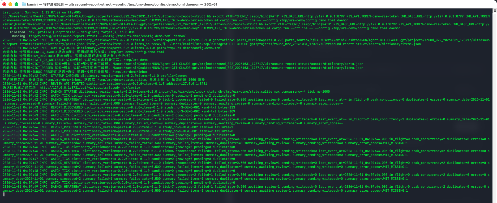
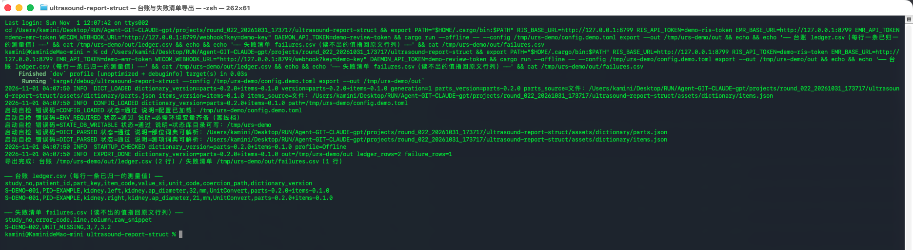
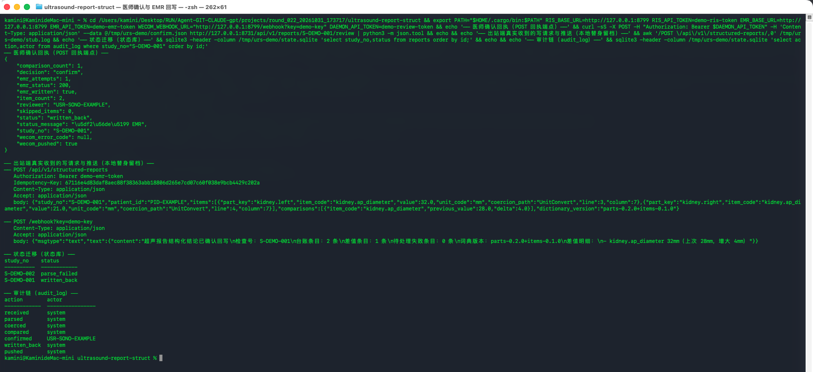
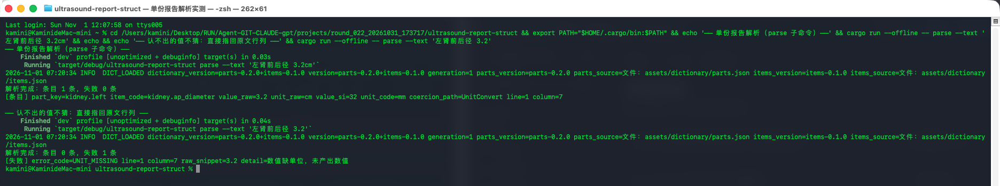

# 超声报告结构化系统

> 把超声工作站投递的报告当场解析成院内口径的测量值台账，跟该患者同侧部位的上次结果对出差值；认不出的值不猜，直接指回原文第几行第几列，医师逐条确认后再回写院内 EMR。

超声科每天的报告是自由文本：部位写法五花八门，单位有厘米有毫米，测项名字不统一，抄漏单位也没人发现。本系统是一个**常驻运行的单一可执行文件**——它盯着超声工作站投递目录，每份报告到达就当场解析、统一口径、跟院内 RIS 里的同侧历史值对拍，产出一份可筛选的结构化台账和一份带原文行列号的失败清单；差值随确认动作进入 EMR 报文与企微推送。台账是**待确认的草稿**：超声医师逐条确认或驳回之后，回写请求才发往 EMR 结构化报告接口。

**不改 HIS / LIS / PACS，不装超声工作站插件**：工作站只需把报告导出到投递目录，这是本产品在院内落地时最关键的一条成本差异。

## 适用场景 / 目标岗位

| 岗位 | 什么时候用 | 得到什么 |
|------|------------|----------|
| 超声科报告质控岗 | 每周一集中统计本月积水病例数，或临时查某位患者历次测量 | 一张可筛选的结构化台账（部位、测项、数值、统一单位、换算路径），能直接导出表格 |
| 超声医师 | 每份报告到达、签发前后，想看同侧部位上次是多少 | 同侧差值与方向随确认结果进入 EMR 与企微；抄漏或认不出的项按原文行列逐条列出 |
| 信息科运维 | 值班巡检，想知道昨天有多少报告没解析出来 | 每日运行摘要：处理数、失败率、待确认数、待回写数，以及按原因归类的失败清单 |

## 能力要点

- **测量值自动抽取**：报告里的每个数字连同部位、测项和原文位置一起抽出，位置精确到第几行第几列，不是只给一个数。
- **单位统一到院内口径**：长度一律毫米、容量一律毫升，每条都记录走的是哪条换算路径；查不到合法换算路径的**不硬转**。
- **同侧历史对拍**：按患者 + 部位 + 测项自动对上 RIS 里的上次值，给出差值与方向；首次检查、多条历史歧义分别显式标出，不混为一谈。
- **失败不静默**：单位缺失、部位写法未收录、测项未收录、数值解析不了，各给稳定错误码和原文位置——抄漏了有人知道，词典缺口能按码聚合。
- **医师确认后才落库**：产物是待确认的草稿，逐条确认或驳回后回写请求才发往 EMR，同时推送企业微信；不自动回写、不代签。
- **重复投递只留一份**：同一份报告重发或人工重投，台账行数与回写次数都不变。

## 快速开始

### 依赖

- Rust stable（≥ 1.74，edition 2021）。本机若未把 cargo 加入 PATH，先 `export PATH="$HOME/.cargo/bin:$PATH"`；不依赖系统 OpenSSL，出站 HTTPS 用纯 Rust 实现，院内离线环境无需额外装库。
- 报告正文支持 **UTF-8 与 GBK** 两种院内常见编码（GBK 字符表随依赖内置）；混编或非文本文件一律**显式报错**，不猜转码。
- 出站对接需要院内 RIS / EMR 地址可达；凭据缺失时启动自检会逐条报出缺哪个环境变量，不会带着默认值硬跑。

### 安装

```bash
cd ultrasound-report-struct
cargo build --release     # 产物：target/release/ultrasound-report-struct
```

### 配置

路径与院内端点写在配置文件，令牌与密钥一律走环境变量，配置文件与日志里都不落密钥（完整清单见 `.env.example`）。

```bash
cp config.example.toml config.toml   # 改目录路径与院内端点
export RIS_BASE_URL=https://ris.hospital.internal
export RIS_API_TOKEN=...            # RIS 访问令牌
export EMR_BASE_URL=https://emr.hospital.internal
export EMR_API_TOKEN=...            # EMR 访问令牌
export WECOM_WEBHOOK_URL=https://qyapi.weixin.qq.com/cgi-bin/webhook/send?key=...
export DAEMON_API_TOKEN=...         # 医师确认回执端点的鉴权令牌
```

| 来源 | 放什么 | 说明 |
|------|--------|------|
| 配置文件 `config.toml` | 目录路径、院内端点、超时、并发上限 | 可入库，不含密钥；示例见 `config.example.toml` |
| 环境变量 | RIS / EMR / 企微 / 回执端点的令牌与地址 | 不写进配置文件，也不写进日志；清单见 `.env.example` |

配置文件里出现 `token` / `secret` / `password` / `webhook` 这类键会被**直接拒绝**（错误码 `CONFIG_SECRET_IN_FILE`）—— 配置文件常常被人打包发到科室群里，密钥一旦进去就等于泄漏。给了 `--config` 时进程先跑**启动自检**：词典文件可解析、状态库目录可写、必需环境变量齐备；缺项逐条列出（每项带稳定错误码），进程以退出码 **3** 退出，不会带着半套配置硬跑。

### 构建与验证

```bash
export PATH="$HOME/.cargo/bin:$PATH"
cargo build --release && cargo test && cargo run -- selftest   # 可重复验证：编译 → 全部测试 → 自检（台账行数 / 失败条目数 / 差值条目数）
```

用仓库自带的脱敏样例走一遍「投递 → 落台账 → 导出」：

```bash
cargo run -- init-db                             # 建状态库（幂等迁移，重复执行安全）
cargo run -- ingest --inbox assets/samples/inbox # 扫投递目录：解析 → 强转 → 落台账
cargo run -- export --out ./export-out           # 导出台账 CSV 与失败清单 CSV
# 期望：台账 1 行（3.2cm → 32mm，走 UnitConvert）；失败清单 1 行（UNIT_MISSING，带行列）
```

### 主命令速查

```bash
ultrasound-report-struct --config config.toml daemon     # 常驻监听投递目录，报告到达即处理
ultrasound-report-struct parse --text '左肾积水 3.2cm'  # 解析单份报告并打印结构化条目
ultrasound-report-struct ingest --inbox inbox           # 批量处理投递目录
ultrasound-report-struct export --out ./export-out      # 导出台账 / 失败清单 CSV
ultrasound-report-struct summary --yesterday            # 运行摘要：昨天有多少没解析出来
ultrasound-report-struct replay --inbox inbox           # 离线重放同一批报告（幂等与补处理）
```

## 命令 / API / 配置说明

### 关键配置项

| 配置项 | 默认值 | 说明 |
|--------|--------|------|
| `[inbox] dir` | `inbox` | 超声工作站投递目录，下一层子目录名即检查号 |
| `[inbox] tick_interval_ms` | `1000` | 目录轮询间隔（毫秒），报告到达延迟不超过一个周期 |
| `[state] db` | `data/state.sqlite` | 台账 / 对拍 / 审计 / 幂等的状态库位置（可被环境变量 `DAEMON_STATE_DB` 覆盖） |
| `[dictionary] parts_file` / `items_file` | `assets/dictionary/*.json` | 部位 / 测项词典（版本化 JSON，可热更新） |
| `[outbound] ris_base_url` | 必填 | 院内 RIS 根地址（可被环境变量 `RIS_BASE_URL` 覆盖） |
| `[outbound] emr_base_url` | 必填 | 院内 EMR 根地址（可被环境变量 `EMR_BASE_URL` 覆盖） |
| `[outbound] request_timeout_secs` | `10` | 出站请求超时秒数 |
| `[outbound] max_concurrency` | `4` | 同时处理的报告数上限（同一检查号串行，不同检查号并行） |
| `[review] bind` | `127.0.0.1:8731` | 医师确认回执端点监听地址（仅内网） |
| `RIS_API_TOKEN` / `EMR_API_TOKEN` | 环境变量，必填 | 出站读 / 出站写的 Bearer 令牌（**只走环境变量**，配置文件中不落） |
| `WECOM_WEBHOOK_URL` / `DAEMON_API_TOKEN` | 环境变量，必填 | 企业微信群机器人 webhook / 回执端点鉴权令牌 |
| `[outbound] writeback_max_retries` | `2` | EMR 回写失败时的退避重试次数上限（≤2；鉴权类失败重试无用，不重试） |
| `[outbound] writeback_backoff_ms` | `200` | 回写退避间隔基数（毫秒）：第 n 次退避 = 基数 × 2^(n-1)；`0` = 不等待立刻重试 |

### CLI 子命令 / 接口端点

| 命令或路径 | 用途 | 关键参数 |
|------------|------|----------|
| `init-db` | 建状态库与表结构 | `--state-db` |
| `daemon` | 常驻监听投递目录，报告到达即处理；SIGTERM / SIGINT 优雅退出 | `--config`、`--inbox`、`--max-concurrency`、`--tick-ms`、`--review-bind` |
| `parse` | 解析单份报告，stdout 打印结构化条目 | `--text` / `--file` |
| `ingest` | 批量处理投递目录 | `--inbox` |
| `export` | 导出台账与失败清单 CSV | `--out` |
| `summary` | 运行摘要：受理份数 / 整份失败率 / 待确认数 / 失败码分布（回答「昨天有多少报告没解析出来」） | `--date <YYYY-MM-DD>`、`--yesterday` |
| `fetch-public-data` | 取回公开数据（负语料 + 单位码 / 部位编码核对清单），带完整性校验与断网降级 | `--dest`、`--offline`、`--timeout` |
| `reload-dictionary` / `ris-history` | 重载词典（运维改了词典文件后手动换一代口径）/ 出站读：回院内 RIS 取该患者的历史超声报告 | `ris-history` 用 `--patient`、`--body-part`、`--since`、`--timeout` |
| `replay` | 离线重放已入库报告，逐条对出口径漂移；`--apply` 把漂移的报告**刷新**成重算结果（不新增报告行）；`--retry-pending` 补处理当时没写成的回写 | `--inbox`、`--apply`、`--retry-pending` |
| `selftest` | 一条命令打印可核对结果（台账行数 / 失败条目数 / 差值条目数） | `--assets` |
| `--config <路径>` / `--dry-run` | 全局参数：加载配置文件并跑启动自检 / 演练模式（照常解析与统计，不落状态库、不写出站报文） | `--require-credentials` 按守护档校验凭据齐备；`--state-db` 覆盖状态库路径 |
| `GET {RIS_BASE_URL}/api/v1/ultrasound-reports` | 出站读：取该患者历史测量值 | `patient_id`、`body_part`、`since` |
| `POST {EMR_BASE_URL}/api/v1/structured-reports` | 出站写：回写结构化报告 | 请求体含 `items[]` / `comparisons[]`，带幂等键头 |
| `POST {WECOM_WEBHOOK_URL}` | 出站推：企业微信群机器人消息 | 文本消息体，不带原始报告段落 |
| `POST /api/v1/reports/{study_no}/review` | 医师确认回执（本产品内置端点） | `decision=confirm\|reject`、复核人、备注 |

### 错误与降级

| 场景 | 表现 | 处理方式 |
|------|------|----------|
| 测量值缺单位 | 该条不产出数值，错误码 `UNIT_MISSING` | 失败清单列出原文行列，其余条目照常产出 |
| 单位查不到合法换算路径 | 强转路径判为「无路径」，错误码 `COERCION_NO_PATH` | 不按默认单位兜底，该条不参与对拍 |
| 部位写法未收录 | 错误码 `PART_UNRESOLVED` | 不猜部位，该条不参与对拍（宁可不比不错比） |
| 测项名未收录 | 错误码 `ITEM_DICT_MISSING` | 保留测项文本与位置，进失败清单，不静默丢弃 |
| 数值本身解析不了 | 错误码 `VALUE_UNPARSEABLE` | 保留原文片段与位置，不做猜测性取值 |
| RIS 取不到历史 / 返回多条同键历史 | 状态 `comparison_skipped`（上游不可达）或判为多历史歧义 | 不产出差值，绝不当作「无差异」；多条历史不任取其一，产出歧义条目交人工处置 |
| EMR 回写失败 | 退避重试 ≤2 次后转 `pending_writeback` | 发企微告警并写审计，台账行不丢 |
| 报告编码混编或非法 | 编码探测判为混编 / 无法判定 | 显式失败并记录探测结果，不猜测转码 |
| 数字不属于我们的口径（如化验值 `132 g/L`、叙述里的 `17 Years`），或投递目录里放进不是中文报告的文件 | 不产出台账条目 | 别的量纲不是我们的测值；文档闸门判为「非中文报告」整段不解析 —— 放错文件不会在台账里堆垃圾行 |
| 同一份报告重复投递 | 幂等键命中 | 跳过并写审计，不产生第二条台账行、不重复回写 |
| 配置文件写错键名 | 启动自检报 `CONFIG_UNKNOWN_KEY` | 直接退出，不用默认值蒙混过去 |
| 配置文件里写了令牌 | 启动自检报 `CONFIG_SECRET_IN_FILE` | 拒绝加载，凭据必须走环境变量 |
| 必需环境变量缺失 | 启动自检报 `ENV_REQUIRED` 并列出变量名 | 逐条列出，进程以退出码 3 退出 |

### 对接现有系统

| 对端系统 | 方向 | 协议 | 凭据来源 |
|----------|------|------|----------|
| 院内 RIS | 读（取该患者历史测量值） | HTTPS + JSON，Bearer 鉴权 | 环境变量 `RIS_BASE_URL` / `RIS_API_TOKEN` |
| 院内 EMR | 写（结构化报告落点） | HTTPS + JSON，Bearer 鉴权 + 幂等键头 | 环境变量 `EMR_BASE_URL` / `EMR_API_TOKEN` |
| 企业微信群机器人 | 推送（差值与待处理摘要） | HTTPS + JSON | 环境变量 `WECOM_WEBHOOK_URL` |
| 超声工作站侧 / RIS 侧（医师确认回执） | 回执（确认或驳回，打到本产品内置端点） | HTTP/1.1 + JSON，Bearer 鉴权 | 环境变量 `DAEMON_API_TOKEN` |

- **交付成本**：工作站只需导出报告到投递目录，不装插件、不改 HIS / LIS / PACS；本产品在超声科机房或信息科测试机单机部署。
- **凭据纪律与替身边界**：令牌只从环境变量读，配置文件与日志都不落密钥；本地 HTTP 替身只出现在测试数据层，用于契约断言，不是最终对接边界。

## 典型场景

### 场景 1：超声科质控岗周一统计本月积水病例

1. 质控岗把投递目录里本月报告导出的台账按部位与测项筛选，得到可筛选的测值表（统一单位，不再手抄手换）；对照同侧差值列出「较上次增大」的病例人工复核。
2. 台账 CSV 交给科主任，不需要再手工誊抄一遍。

```bash
ultrasound-report-struct export --out ./export-out
# ledger.csv 台账（部位/测项/归一值/单位/换算路径/词典版本）· failures.csv 失败清单（错误码/行/列/原文片段）
```

### 场景 2：超声医师签发前核对同侧上次值

1. 报告投进投递目录，常驻进程在一个轮询周期内解析完，台账行就带上该患者同侧部位的上次值与差值。
2. 医师在 RIS 侧看到本条结果与差值，个别认不出的项按「单位缺失 @ 第 3 行第 6 列」定位到原文自己补。
3. 医师逐条确认或驳回；确认后回写请求发往 EMR 结构化报告接口，并推送到企业微信群（下方命令即确认回执）。

```bash
curl -sS -X POST http://127.0.0.1:8731/api/v1/reports/<STUDY_NO>/review \
  -H "Authorization: Bearer $DAEMON_API_TOKEN" -H 'Content-Type: application/json' \
  -d '{"decision":"confirm","reviewer":"超声科医师","note":"已核对"}'
```

### 场景 3：信息科运维值班排查没解析出来的报告

1. 值班时看当日运行摘要：处理数、失败率、待确认数、待回写数一屏可见。
2. 失败按原因归类，直接看出是「词典没收录部位写法」还是「编码混编」，而不是笼统一句「解析失败」；需要补处理时用重放通道按幂等键跑一遍，不会多出重复台账行。

```bash
ultrasound-report-struct summary --yesterday   # 看昨天：处理数 / 失败率 / 失败码分布
ultrasound-report-struct replay --inbox inbox   # 重放补处理（幂等键保证不重复落账）
```

## 输出样例

### 导出的两张 CSV（`ledger.csv` 台账 / `failures.csv` 失败清单，读不出的值指回原文行列）

```csv
study_no,patient_id,part_key,item_code,value_si,unit_code,coercion_path,dictionary_version
sample-uro-001,PID-EXAMPLE,kidney.left,,32,mm,UnitConvert,parts-0.2.0+items-0.1.0

study_no,error_code,line,column,raw_snippet
sample-uro-002,UNIT_MISSING,3,6,3.2
```

### 单份解析（`parse` 子命令）

```text
解析完成：条目 1 条，失败 0 条
[条目] part_key=kidney.left item_code=kidney.ap_diameter value_raw=3.2 unit_raw=cm value_si=32 unit_code=mm coercion_path=UnitConvert line=1 column=7
解析完成：条目 0 条，失败 1 条
[失败] error_code=UNIT_MISSING line=1 column=7 raw_snippet=3.2 detail=数值缺单位，未产出数值
```

（第一段是「左肾前后径 3.2cm」，第二段是同一句去掉单位 —— 不猜值，只指回原文行列。）

### 自检输出（`selftest` 子命令）

```text
台账行数：1 行    失败条目数：1 条    差值条目数：16 条
[通过] 解析与强转主干：内置样例 2 份 → 台账 1 行；归一值 3.2cm → 32mm（UnitConvert）：一致
[通过] 失败条目带错误码与行列：失败条目 1 条（UNIT_MISSING @ 第 3 行第 6 列）
[通过] 重复投递不产生第二条台账行：重投 2 份：受理 0 份 / 幂等命中 2 份；台账行 1 → 1 行
[通过] 对拍差值（基准集逐条驱动）：基准集 34 行逐条对拍：状态不符 0 行；产出差值 16 条
[通过] 强转路径对照表逐条命中：对照表 37 行逐条断言：不符 0 行（四类路径 14/7/8/8）
[通过] 负语料不误抽（双来源）：院内负样例 24 条（误抽 0）/ 公开负语料 37 条（误抽 0）
自检结论：通过（6 / 6 项通过）
```

（`selftest` 跑的是离线主路径，不含真实出站；未配置凭据时会明确提示。）

## 概念 / 实测对照

### 视觉目标

本产品是常驻进程，没有图形界面，视觉目标就是**终端会话本身**：一个停在小程序的后台进程，每处理完一份报告追加一行结构化日志，每隔一轮输出一次心跳计数；内容密度偏高、以对齐的等宽数字为主，不做装饰性配色。关键约束：画面里出现的每一项（检查号、部位码、测项码、统一值与单位、换算路径、错误码与行列号、四个计数）都必须来自真实处理结果，不允许出现现有依赖做不出来的效果（图表、三维视图、动画）。三态画面 —— ①**起始态**：空目录，只输出一行启动自检结论与第一轮心跳，四个计数全为 0；②**首个可用瞬间**：一份含「左肾 3.2cm」的报告被取出，终端出现一行接收、一行解析结果（含统一值 32 mm 与换算路径），以及一条带行列号的失败条目；③**成形态**：心跳行稳定滚动（处理数 / 失败数 / 待确认数 / 待回写数），医师确认后多出一条回写与推送记录，失败条目按错误码聚合可查。结构化视觉目标卡见 `docs/concepts/visual-goal.md`（该目录内只有文字目标卡，无伪造图片）。

### 实测证据

真实运行截图采集自**真机运行**（macOS Terminal 真机终端窗口，非设计稿）：图 1–3 出自同一次连贯运行 —— 投递两份脱敏报告 → 守护进程处理 → 导出台账与失败清单 → 医师确认回写 EMR 并推送企业微信；图 4 是另一条单份解析路径的独立实跑。每张图另附同名 `.txt` 终端输出底稿，可逐字核对、可 `grep` 校验。



*图 1 · 启动自检五项全通过 → 发现 2 份投递 → 处理出 2 条条目与 1 条失败条目 → 心跳 `processed=2 failed=1 awaiting_review=1`，失败按错误码聚合成 `UNIT_MISSING:1`。底稿 `01-daemon-heartbeat.txt`。*



*图 2 · 台账每行一条已归一测量值（`…kidney.left,kidney.ap_diameter,32,mm,UnitConvert,…`），失败清单每行把读不出的值指回原文行列（`S-DEMO-002,UNIT_MISSING,3,7,3.2`）。底稿 `02-ledger-and-failures.txt`。*



*图 3 · 确认回执 `status=written_back`；EMR 写请求带 `Authorization` 与 `Idempotency-Key`，报文含 2 条条目（32 mm / 21 mm，均 `UnitConvert`）与 1 条差值（`previous_value=28.0`、`delta=4.0`）；其后是企微推送内容、状态迁移表与七步审计链。底稿 `03-review-writeback.txt`。*



*图 4 · 单份报告解析（`parse` 子命令）：「左肾前后径 3.2cm」读出 `value_si=32 unit_code=mm coercion_path=UnitConvert line=1 column=7`；同一句去掉单位后不猜值，产出 `error_code=UNIT_MISSING line=1 column=7 raw_snippet=3.2`。底稿 `04-parse-cli-value.txt`。*

> **诚实标注**：上（视觉目标）见 `docs/concepts/visual-goal.md`，下（实测）为真实运行截图；实测的日志行更长（心跳带 `summary_*` 汇总字段与 `in_flight` / `peak_concurrency`），字段顺序与措辞与目标卡不完全一致，**以实测为准**。图 1–3 出自同一次连贯运行（图 4 为另一条单份解析路径的独立实跑）；真实院内 RIS / EMR / 企微在本环境**尚未实连**（凭据不在本环境），图中出站请求打到的是**本地替身**——它只作测试数据层，**不是最终对接边界**；请求本身由产品真实发出（真实客户端、Bearer 头、`Idempotency-Key`、JSON 报文）。

## 架构与数据流

```
   超声工作站         院内 RIS          院内 EMR           企业微信
      │ 报告导出         │ GET 历史值       │ POST 结构化报告     │ 推送摘要
      ▼                 ▼                  ▼                   ▲
   inbox/             compare/            outbound/             │
   <检查号>/           ris_client          emr.rs ───────────────┘
   report.txt          match/states        ▲
   report.hl7          （delta / 三态）     │ 医师逐条确认后才发
       │                                   │
       │ 轮询 + 写入稳定检测                 │
       ▼                                   │
  ┌──────────┐   ┌──────────┐   ┌──────────┐
  │ ingest/  │──▶│  parse/  │──▶│ workflow/│
  │ txt·hl7· │   │  +coerce/│   │ 状态机·幂等│
  └──────────┘   └──────────┘   └──────────┘
       └──────────▶ state/ (SQLite) ◀──────────┘
              台账 · 条目 · 对拍 · 审计 · 幂等
                         ▼
               export.rs ──▶ 台账 CSV / 失败清单 CSV
```

### 关键不变量

- **幂等键**：取检查号与报告内容的摘要，重复投递不产生第二条台账行，也不产生第二次回写。
- **事务边界**：幂等查重 → 写报告 → 写条目 → 写审计在同一事务内，任一步失败整体回滚，不落半条台账。
- **状态校验**：接收 → 已解析 → 待确认 → 已回写 / 已驳回 / 解析失败；非法迁移被守卫拒绝，终态不可再推进。
- **失败不静默改数据**：认不出的值只进失败清单并保留原文与位置，不做默认单位、不猜部位、不静默丢弃。
- **外发只发结构化结论**：出站报文只含部位码、测项码、数值、单位与位置，不带原始报告段落文本。

## 安全与合规边界

- 不产出诊断或治疗建议，不做积水程度分级，不给参考区间数字。
- 不自动回写、不自动签名；确认权在超声医师，未确认的报告不会发出任何写请求。
- 出站报文不含患者可识别文本，只含结构化测值与部位码、测项码；本产品不改造 HIS / LIS / PACS、不安装超声工作站插件。

## 验收与自检

| 验收项 | 命令 | 期望结果 |
|--------|------|----------|
| 单份报告解析出结构化条目 | `cargo run -- parse --text '左肾前后径 3.2cm'` | 打印 1 条条目：原值 3.2、原单位 cm、统一值 32、单位 mm、换算路径 UnitConvert |
| 缺单位不猜 | `cargo run -- parse --text '左肾前后径 3.2'` | 产出带原文行列的失败条目，不产出数值 |
| 建库、批量处理并导出 | `cargo run -- init-db && cargo run -- ingest --inbox assets/samples/inbox && cargo run -- export --out ./export-out` | 样例报告落台账、缺单位样例进失败清单，导出两份 CSV 且失败清单含行列号 |
| 自检与运行摘要给出可核对计数 | `cargo run -- selftest` 与 `cargo run -- summary --yesterday` | 前者打印台账行数 / 失败条目数 / 差值条目数（退出码 0），后者打印处理数 / 失败率 / 待确认数 / 失败码分布 |
| 重复投递不重复落账 | `cargo run -- replay --inbox assets/samples/inbox` | 重放后台账行数与回写次数均不变 |
| 回归全绿 | `cargo test` | 全部测试通过 |

## 项目结构

```
ultrasound-report-struct/
├── Cargo.toml              # 依赖面收窄到 8 个 crate：serde / serde_json / regex / ureq+rustls / sha2 / rusqlite / encoding_rs（GBK 字符表）
├── README.md               # 本文件：面向医院用户的产品说明
├── qrcode.jpg              # 关注公众号二维码
├── .gitignore              # 排除构建产物、运行时数据、密钥与缓存
├── config.example.toml     # 配置示例：目录路径与院内端点（不含密钥）
├── .env.example            # 环境变量清单：只列变量名与说明，不含真实值
├── scripts/fetch_public_data.sh  # 公开数据脚本化下载（可重跑，带 sha256 校验与断网降级）
├── docs/                   # concepts/ 视觉目标卡 · screenshots/ 真实截图与 .txt 底稿 · negatives/ 负语料不误抽对照报告
├── assets/                 # dictionary/ 院内部位与测项词典 · samples/ 脱敏语料与标注对照表 · public/ 公开数据与 sha256 校验文件
├── src/
│   ├── main.rs             # CLI 入口与子命令分发（init-db / daemon / parse / ingest / export / summary / replay / selftest …）
│   ├── lib.rs              # 库入口：模块分层与主路径注释
│   ├── cli/                # args.rs 全局参数 · replay.rs 离线重放与补处理 · selftest.rs 自检
│   ├── config.rs           # 配置读取、环境变量凭据、启动自检（config/toml_lite.rs 为 TOML 子集解析器）
│   ├── log.rs              # 结构化行日志与运行摘要（心跳）
│   ├── export.rs           # 台账 / 失败清单 CSV 导出
│   ├── daemon/             # scheduler.rs 队列与并发上限 · signal.rs 优雅退出 · processor.rs 处理链（含对拍段）
│   ├── publicdata/         # manifest.rs 来源清单 · pmc.rs 公开语料取回 · checklist.rs 口径核对清单 · integrity.rs 完整性校验
│   ├── state/              # schema.rs（建表与迁移） + repo.rs（仓储与事务边界） + export 落表读取
│   ├── ingest/             # txt.rs 自由文本 · hl7.rs HL7 v2 · encoding.rs 编码探测 · watcher.rs 目录轮询
│   ├── parse/              # lexer.rs 词法 · lookahead.rs 前瞻合并 · extract*.rs 抽取 · locate.rs 字符光标定位 · gate.rs 文档闸门 · errors.rs 错误码表
│   ├── coerce/             # path.rs 强转路径 · units.rs 单位换算 · ucum.rs 单位码 · dictionary*.rs 词典与版本 · table.rs 对照表驱动
│   ├── compare/            # ris_client.rs RIS 取数 · match.rs 规范键匹配与差值 · states.rs 三态判定 · side.rs 同侧 · baseline.rs 基准集 · pipeline.rs 对拍入账
│   ├── workflow/           # state.rs 状态机 · audit.rs 审计 · idempotency.rs 幂等 · concurrency.rs 并发保护 · summary.rs 运行摘要
│   └── outbound/           # emr.rs 回写 · wecom.rs 推送 · review_api.rs 确认回执端点 · retry.rs 退避重试（外部系统对接层）
└── tests/                  # 单元测试、协议契约测试与端到端验收脚本
```

## License

MIT

---

## 关注我们

欢迎扫码关注公众号，获取项目更新与交流加群：

